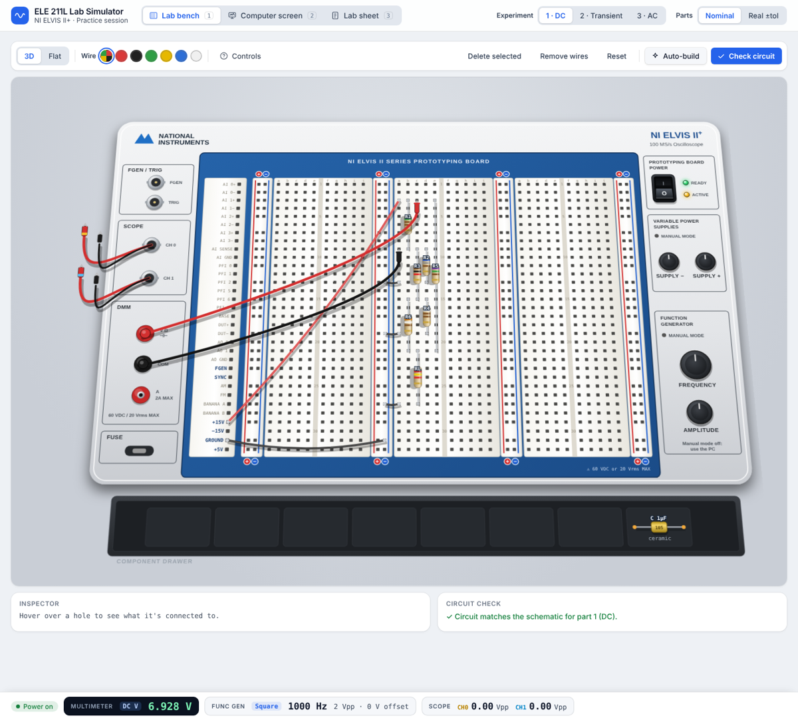

# ⚡ ELE 211L Lab Simulator

A browser-based simulator of the **NI ELVIS II+** workstation for practising the ELE 211L (Electric Circuits I) lab final at the American University of Sharjah: DC measurements, Thevenin equivalents, RC transients and AC steady state.

**[▶ Open the live simulator](https://3hsann.github.io/3HSANN/vibe-coded/ele211-lab-simulator/)**. You can also download `index.html` and open it in any browser. It's a single file with no build step.



## Features

- **3D ELVIS II+ bench.** A prototyping board with vertical breadboard strips, power rails, header pins (+15V, −15V, GROUND, +5V, FGEN), scope BNCs, DMM banana jacks and a working power switch with a click sound.
- **Real wiring.** Drag jumper wires between holes, place parts from the component drawer and move each lead. The DMM leads and scope clips plug in like the real ones, and the red plug moves between VΩ and A.
- **Circuit solver.** A nodal (MNA) solver for DC, plus a backward-Euler transient solver with an adaptive time step for the capacitor circuits.
- **Realistic faults.** Supply shorts, an ammeter across a source, the ohmmeter used on a powered circuit, and a scope ground clip that grounds a node.
- **Computer screen tab.** Mock NI ELVISmx panels for the DMM (V⎓, V~, A⎓, A~, Ω), the function generator (sine, square, triangle) and the oscilloscope (Immediate/Edge trigger, slope, cursors, autoscale, RMS / Vp-p readouts).
- **Lab sheet.** The schematic, step-by-step procedure, and a worksheet that checks your measured values within 3%.
- **Check circuit.** Compares your breadboard wiring with the schematic and tells you which part is misplaced.

## Verified against theory

| Quantity | Simulator | Hand calculation |
|---|---|---|
| V1 | 6.928 V | 6.928 V |
| Voc / Isc / Rth | 9.866 V / 23.83 mA / 413.9 Ω | same |
| τ = Rth·C | 0.414 ms | 0.414 ms |
| Vc at 1 kHz | 2.36 Vpp, −69° | same |

## Host it on GitHub Pages

1. In this repo go to **Settings → Pages**.
2. Under **Build and deployment**, set **Source: Deploy from a branch**, **Branch: `main`**, folder **`/ (root)`**, then **Save**.
3. After a minute the simulator is live at
   **https://3hsann.github.io/3HSANN/vibe-coded/ele211-lab-simulator/**

## Visitor tracking

The page has [GoatCounter](https://www.goatcounter.com) built in. It's free and open source, and it doesn't use cookies, so you don't need a consent banner.

1. This site uses the code `3hsannn`. The dashboard is at `https://3hsannn.goatcounter.com`.
2. The code is set near the top of `<body>` in `index.html`:
   ```js
   window.ANALYTICS={goatcounter:"3hsannn",showCount:true};
   ```
3. Optional: to show the live count (👥 N visits) in the status bar, go to GoatCounter **Settings** and tick *Allow adding visitor counts on your website*.

Besides page views and unique visitors (with their country, browser and screen size), the dashboard shows which tools people use. These appear as events:
`check-circuit`, `auto-build`, `experiment-dc/tr/ac`, `open-computer-screen`, `open-lab-sheet`, `check-worksheet`, `scope-autoscale`, `real-parts`.

Tracking only runs on the hosted page. It stays off when you open the file locally or view the claude.ai preview.

Built with plain HTML, SVG, Canvas and JavaScript (no frameworks). Vibe-coded with Claude.
